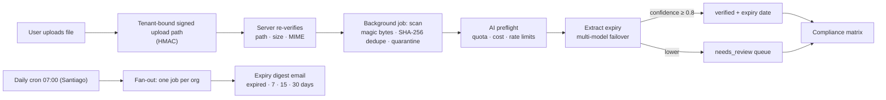

# DocuHR — Labor Compliance Documents, Tracked by AI

**A multi-tenant SaaS that helps Chilean contractor companies keep every worker's paperwork valid for every client — with AI expiry extraction, a compliance matrix, and proactive alerts.**

[Marco Alvarado](https://github.com/7pixel-cl) · [Portfolio](https://7pixel.cl) · [LinkedIn](https://www.linkedin.com/in/marcoalvaradot/)

> Production source is private. This repository is a public case study — no code, customer data, or infrastructure details.

## At a glance

| | |
| --- | --- |
| **Role** | Product owner & sole engineer |
| **Users** | Document managers, supervisors, and admins at contractor companies |
| **Status** | Advanced MVP — Phase 1 (9 epics) shipped through 15 reviewed pull requests |
| **Scale of the codebase** | ~21k lines of TypeScript · 15 tables · ~150 automated tests (unit, cross-tenant RLS, E2E) |

## The problem

In Chile, contractor companies (mining, construction, facilities) can only send a worker to a client site if that worker's documents are current *for that specific client*: health certificates, safety courses, contracts, insurance. Each client asks for a different set, documents expire on different dates, and a single expired certificate can block a whole crew at the gate.

Most companies track this in spreadsheets and shared folders — so the first sign of a problem is usually a rejected worker.

## What I built

- **Compliance matrix** — a virtualized workers × document-types grid per client company, showing at a glance what's valid, expiring, missing, or expired, plus a daily "what to do today" banner.
- **Secure uploads with version history** — notes, previous versions, and an audit trail per document.
- **AI expiry extraction** — the system reads the uploaded document and extracts its expiry date; high-confidence results are verified automatically, the rest go to a human review queue with a confidence badge.
- **Proactive alerts** — a daily job groups documents into *expired / 7 / 15 / 30 days* per organization and emails the right people.
- **Bulk onboarding** — worker import from Excel and reusable per-client requirement templates.
- **Multi-organization accounts** — users can belong to several companies and switch between them.

## Document pipeline

## Engineering highlights

### 1. Tenant isolation the database enforces — and CI polices
Row-level security is **forced** on every tenant table. A custom CI check **fails any migration** that adds a tenant table without RLS and a policy, and cross-tenant tests run in CI as a non-superuser role, so a leaking query is caught before merge, not in production.

### 2. Upload security as a pipeline, not a checkbox
Upload URLs are bound to the tenant with an HMAC and re-verified server-side; files are checked by magic bytes (not extension), deduplicated by hash, and quarantined if anything looks wrong — all in background jobs so the UI stays fast.

### 3. Cost-aware, multi-provider AI
Extraction goes through a small model router that chooses providers per subscription plan and **fails over** between them. A preflight step enforces per-org quotas, rate limits, and a cost budget (converted to local currency), and every call's usage is logged — so AI spend is predictable for a B2B price point.

### 4. Human-in-the-loop by design
Confidence thresholds decide what is auto-verified and what goes to a person. The UI shows *why* a document is flagged, so reviewers trust the automation instead of re-checking everything.

### 5. Production-grade operations from day one
Error tracking, structured logs, product analytics, feature flags, Redis rate limiting, transactional email with single-use unsubscribe tokens, and legal templates (terms, privacy, DPA) — the unglamorous parts that let a small SaaS sell to real companies.

## Stack

Next.js 16 · React 19 · TypeScript (strict) · tRPC 11 · Drizzle ORM · PostgreSQL (Neon) with RLS · Auth.js v5 · Inngest · Vercel Blob · Vercel AI SDK (Gemini, Claude, OpenAI) + document-AI parsing · Resend + React Email · Upstash Redis · Sentry · Axiom · PostHog · GrowthBook · Vitest · Playwright · Vercel

## What I learned

AI is the headline, but the value is in the plumbing around it: confidence thresholds, review queues, cost guards, and alerts that arrive *before* a worker is turned away. Treating multi-tenancy as a database guarantee — enforced by CI — was the decision that made everything else safe to build quickly.

---

© 2026 Marco Alvarado. All rights reserved. This showcase does not license the production software.
